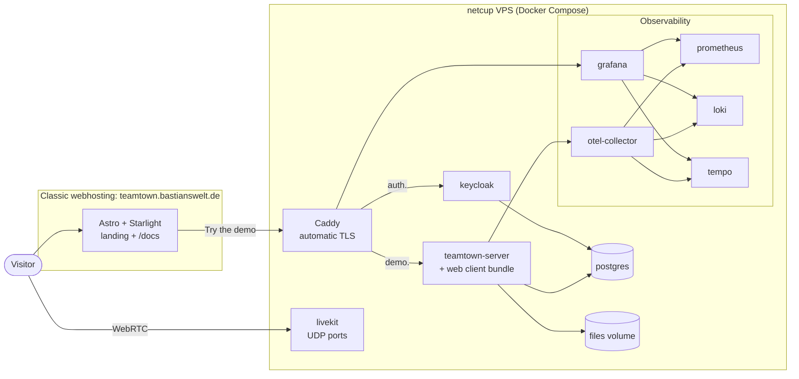

# Deployment

Decided ([ADR-0013](adr/0013-deployment-vps-docker-compose.md), [ADR-0017](adr/0017-runtime-infrastructure.md),
[ADR-0019](adr/0019-observability-full-stack.md), [ADR-0025](adr/0025-showcase-hosting-and-website.md)):

- The **showcase instance** runs on a **netcup VPS** with **Docker Compose**.
- The owner's **classic webhosting** (PHP + MySQL, FTP, no SSH, no long-running processes) serves only
  **static content**: the Astro + Starlight website with the landing page and docs.
- **Self-hosters** use the same Docker Compose setup.

## Why not the webhosting for the app?

TeamTown needs long-running processes (Node.js server, Keycloak, LiveKit), WebSockets and open UDP
ports for WebRTC/TURN. Classic shared hosting provides none of these. The architecture is kept as
designed instead of being bent around the hosting.

## Hostnames

Base domain: `teamtown.bastianswelt.de` (the owner still has to create it).

| Hostname | Content | Hosted on |
|----------|---------|-----------|
| `teamtown.bastianswelt.de` | Landing page; documentation under `/docs` | Classic webhosting |
| `demo.teamtown.bastianswelt.de` | TeamTown app: web client, REST API, WebSocket | netcup VPS (Caddy) |
| `auth.teamtown.bastianswelt.de` | Keycloak | netcup VPS (Caddy) |
| LiveKit signalling / TURN | open question | netcup VPS |
| Grafana (admin only) | open question | netcup VPS (Caddy + auth) |

## Topology (showcase)

## Compose services

| Service | Purpose |
|---------|---------|
| `caddy` | Reverse proxy, automatic HTTPS |
| `server` | NestJS server (REST, WebSocket gateway, outbox relay); serves the built web client |
| `keycloak` | OIDC identity provider (pre-configured realm export) |
| `livekit` | WebRTC SFU with built-in TURN |
| `postgres` | Databases for TeamTown (one schema per module) and Keycloak |
| `otel-collector`, `prometheus`, `loki`, `tempo`, `grafana` | Observability stack, always on (ADR-0019) |

Volumes: `postgres-data`, `files` (uploads, ADR-0017), `prometheus-data`, `loki-data`, `tempo-data`, `grafana-data`, `caddy-data`.
Backups must cover the PostgreSQL dumps **and** the `files` volume.

## Sizing (estimate, to be verified by load test)

The always-on observability stack adds about 1.5–2 GB RAM.

| Users online | VPS (estimate) |
|--------------|----------------|
| Showcase / < 50 | 6–8 vCPU, 12–16 GB RAM |
| 50–500 | 8+ vCPU, 16–32 GB RAM; LiveKit possibly on its own host |

Audio/video bandwidth dominates the cost, because with an SFU every subscribed stream is routed through the server.
The concrete netcup product is an open question.

## Static website on the webhosting

- `apps/website` (Astro + Starlight) is built by GitHub Actions on pushes to `main`. It includes the Markdown from `docs/`.
- It is uploaded via an **FTP(S) deploy action** to the webhosting. The FTP credentials live in GitHub Actions secrets.
- No secrets and no server-side logic. The PHP capability of the hosting stays unused.

## Desktop app distribution

Built with electron-builder in GitHub Actions and published as **GitHub Releases** under
`<github-user>/teamtown`. Builds are **unsigned at first**: the docs explain the SmartScreen (Windows) and
Gatekeeper (macOS) warnings. Auto-update works on Windows and Linux; macOS needs manual updates until signing is added.

## Showcase demo mode (decided)

- Visitors log in as **guests with a generated avatar**, without registration.
- **Demo bot colleagues** walk around, greet visitors and demonstrate conversations, knocking and room walls.
- All demo data is **reset nightly**.
- Goal: a visitor walks and talks within **60 seconds** of opening the demo.
