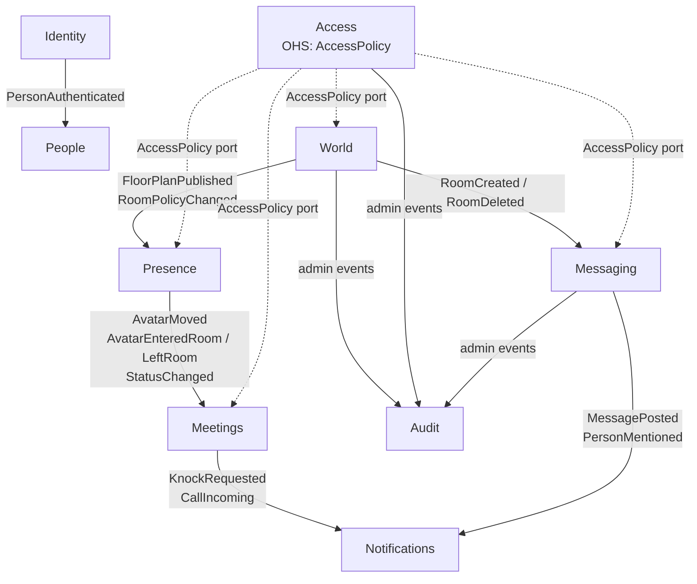

# Domain Model

> The bounded contexts follow from the decided MVP areas. Aggregate boundaries are a **first design
> (proposal)** and will be refined during implementation. Changes go through an ADR if they move a
> context boundary.

## 1. Ubiquitous language (glossary)

Use these terms consistently in code, UI, docs and conversations. Code identifiers are in English.

| Term                | Meaning                                                                                                  | Code name                                  |
| ------------------- | -------------------------------------------------------------------------------------------------------- | ------------------------------------------ |
| **Town**            | One TeamTown instance = one company (single tenant)                                                      | `Town` (config/settings, not an aggregate) |
| **Floor**           | A level of the office, rendered as an isometric tile grid                                                | `Floor`                                    |
| **Floor plan**      | The layout of a floor: tiles, walls, doors, furniture, room areas. Has _draft_ and _published_ versions. | `FloorPlan`                                |
| **Tile**            | One cell of the floor grid; the unit for walking, placing and pathfinding                                | `TileCoord {x, y}`                         |
| **Room**            | A named area of a floor with its own policy (door mode, capacity, audio isolation)                       | `Room`                                     |
| **Door mode**       | A room's access mode: `open`, `knock` or `locked`                                                        | `DoorMode`                                 |
| **Spawn point**     | A tile where people appear when they enter a floor                                                       | `spawnPoints[]` in `FloorPlan`             |
| **Desk**            | A furniture item that can be assigned to a person; their spawn point                                     | `Desk`                                     |
| **Avatar**          | A person's figure in the world                                                                           | `Avatar`                                   |
| **Presence**        | A person's live state: where they are, status, visibility. **Never persisted.**                          | `PresenceState`                            |
| **Status**          | `available`, `busy`, `in-meeting`, `focus`, `away`, `offline`                                            | `PresenceStatus`                           |
| **Focus mode**      | Status that suppresses proximity audio and non-urgent notifications                                      | `focus`                                    |
| **Ghost mode**      | Online but invisible in the world                                                                        | `visibility: hidden`                       |
| **Conversation**    | An ad-hoc proximity group of avatars that can hear each other (shown as a _bubble_)                      | `Conversation`                             |
| **Audio isolation** | A room property: proximity audio does not reach into or out of the room; it has its own room call        | `audioIsolated`                            |
| **Audio check**     | The step before entering the office: microphone permission, level meter and speaker test                 | `AudioCheck`                               |
| **Room call**       | The audio/video session bound to a room. You join it by entering the room.                               | `RoomCall`                                 |
| **Direct call**     | A call to a person independent of location                                                               | `DirectCall`                               |
| **Logged meeting**  | A room call the host explicitly started as logged: title, participants and times are stored              | `MeetingLog`                               |
| **Knock**           | A request to enter a `knock`-mode room                                                                   | `KnockRequest`                             |
| **Occupant**        | A person whose avatar is inside a room                                                                   | `roomId` in `AvatarState`                  |
| **Entry pass**      | A short-lived right for one person to walk into a `knock` or `locked` room (after a knock or on return)  | `EntryPass`                                |
| **Channel**         | A persistent message stream: `public`, `private`, `announcement`, `room` or `direct`                     | `Channel`                                  |
| **Room wall**       | The channel linked to a room                                                                             | `Channel{kind: room}`                      |
| **Thread**          | Replies to one message                                                                                   | `Thread`                                   |
| **Followed thread** | A thread whose new replies count as unread for a person (root author, repliers, mentioned people)        | `ThreadFollow`                             |
| **Mention**         | `@person` in a message; notifies members of the channel                                                  | `mentions[]`                               |
| **Reaction**        | An emoji a person attaches to a message                                                                  | `reactions[]`                              |
| **Emote**           | A reaction shown briefly above the avatar (public channels only, never stored)                           | `AvatarEmoted`                             |
| **Person**          | A member's profile (name, avatar look, locale, desk)                                                     | `Person`                                   |
| **Guest**           | An external person with access limited to explicitly shared resources                                    | `role: guest`                              |
| **Role**            | A named set of permissions                                                                               | `Role`                                     |
| **Scope**           | Where a role assignment applies: town, floor, room or channel                                            | `Scope`                                    |

## 2. Bounded contexts

| Context           | Type       | Responsibility                                                                                                      | Persistence                                                                |
| ----------------- | ---------- | ------------------------------------------------------------------------------------------------------------------- | -------------------------------------------------------------------------- |
| **World**         | Core       | Floors, floor plans (draft/published), rooms and policies, furniture catalogue, editor commands, desks              | PostgreSQL                                                                 |
| **Presence**      | Core       | Live avatar positions, movement validation and pathfinding, status, visibility, floor occupancy                     | **In-memory only**                                                         |
| **Meetings**      | Core       | Proximity conversations, room calls, direct calls, knocks, screen-share state; LiveKit tokens and track permissions | In-memory, except the opt-in `MeetingLog` (ADR-0026)                       |
| **Messaging**     | Core       | Channels, memberships, messages, threads, reactions, mentions, search                                               | PostgreSQL                                                                 |
| **Access**        | Supporting | Roles, permission sets, role assignments per scope, policy evaluation (`AccessPolicy`)                              | PostgreSQL                                                                 |
| **People**        | Supporting | Profiles, avatar appearance, preferences, locale                                                                    | PostgreSQL                                                                 |
| **Files**         | Supporting | Uploads, previews, file references from messages                                                                    | PostgreSQL (metadata) + `FileStorage` port: Docker volume or S3 (ADR-0017) |
| **Notifications** | Supporting | In-app and OS notifications, preferences, mention and knock delivery                                                | PostgreSQL                                                                 |
| **Identity**      | Generic    | Mapping the OIDC subject (Keycloak) to a person, session handling. No passwords.                                    | PostgreSQL (mapping only)                                                  |
| **Audit**         | Generic    | Append-only log of administrative actions                                                                           | PostgreSQL                                                                 |

## 3. Context map

- **Solid arrows** are domain events (asynchronous, in-process event bus). The downstream context reacts.
- **Dotted arrows** are synchronous queries through a published port (`AccessPolicy`). Access is an
  _open host service_. Other contexts never read Access tables.
- **People** is queried by display-oriented read models (names, avatar look), not by business rules.

## 4. Aggregates (first design)

### World

- **`FloorPlan`** (root): `floorId`, `version`, `status: draft | published`, `grid {width, height}`,
  `tiles[]` (floor material, walkable), `walls[]` (edge-based, material: solid | glass), `doors[]`,
  `furniture[] {catalogItemId, tile, rotation, deskAssignee?}`, `roomAreas[] {roomId, tiles}`.
  - Invariants: doors sit on walls; room areas don't overlap; every room is reachable from a spawn
    tile; a published version is immutable.
- **`Room`** (root): `roomId`, `floorId`, `name`, `doorMode`, `capacity?`, `audioIsolated`, `wallChannelId?`.
  - Separate from `FloorPlan` because policies change at a different pace and with different permissions than geometry.

### Presence (in-memory)

- **`FloorInstance`**: the runtime of one published floor plan, with its walkability grid, occupancy and
  `AvatarState[]`.
- **`AvatarState`**: `personId`, `tile`, `path?`, `facing`, `status`, `visibility`, `roomId?`.
  - Invariants: only walkable tiles; entering a room requires a decision from Access + door mode.
- **Live door mode** per room: starts at the floor plan's `doorMode`, changed by occupants until M4, reset when the
  room empties. Plus entry passes and the 30 s grace period. Presence owns it because it enforces paths
  (decided 2026-10-30, M2b).

### Meetings (mostly in-memory)

- **`Conversation`**: `participants[]`, `locked`, derived from proximity and walls.
- **`RoomCall`**: `roomId`, `participants[]`, `screenShares[]`.
- **`DirectCall`**: `caller`, `callee`, `state: ringing | active | ended`.
- **`KnockRequest`**: `roomId`, `requester`, `state`, `expiresAt`.
- **`MeetingLog`** (the only persisted Meetings aggregate; created only by explicit host action, ADR-0026):
  `roomId`, `title`, `participants[]`, `consents[] {personId, consentedAt}`, `startedAt`, `endedAt?`, `expiresAt`.
  Invariant: only persons with a recorded consent are participants (ADR-0027).

### Messaging

- **`Channel`** (root): `kind`, `name`, `visibility`, `memberships[]`, `archived`.
- **`Message`** (root, references `channelId`): `author`, `body` (Markdown subset), `threadRootId?`,
  `alsoInChannel`, `mentions[]`, `reactions[]`, `attachments[]`, `editedAt?`, `deletedAt?`; a root keeps its thread
  summary (reply count, newest reply, repliers).
  - A separate aggregate so that high-volume messages don't lock the channel.
- **`ThreadFollow`** (per person and thread root): `following`, `readMarker?` (ADR-0034).

### Access

- **`Role`**: `roleId`, `name`, `permissions[]`, `builtIn`.
- **`RoleAssignment`**: `principal (person | group)`, `roleId`, `scope`.

## 5. Domain events (initial catalogue)

| Context   | Event                                                                                                                                                                                                          | Main consumers                                  |
| --------- | -------------------------------------------------------------------------------------------------------------------------------------------------------------------------------------------------------------- | ----------------------------------------------- |
| Identity  | `PersonAuthenticated`                                                                                                                                                                                          | People (create profile on first login)          |
| World     | `FloorPlanPublished`, `RoomCreated`, `RoomPolicyChanged`, `RoomDeleted`, `DeskAssigned`                                                                                                                        | Presence, Messaging, Audit                      |
| Presence  | `AvatarMoved`, `AvatarEnteredRoom`, `AvatarLeftRoom`, `DoorModeChanged`, `StatusChanged`, `PersonWentOnline/Offline`                                                                                           | Meetings, gateway                               |
| Meetings  | `ConversationFormed/Changed/Dissolved`, `RoomCallChanged`, `KnockRequested/Answered`, `DirectCallRequested`, `MeetingLogStarted/Ended`                                                                         | Notifications, gateway                          |
| Messaging | `MessagePosted`, `MessageEdited`, `MessageDeleted`, `PersonMentioned`, `ChannelChanged`, `ChannelLeft`, `ReadMarkerMoved`, `ThreadUpdated`, `ReactionsChanged`, `ThreadFollowChanged`, `ThreadReadMarkerMoved` | Notifications, gateway, Presence (emote), Audit |
| Access    | `RoleCreated/Changed`, `RoleAssigned/Revoked`                                                                                                                                                                  | Audit, permission cache invalidation            |

Naming rule: past tense, the context name implied by the module, payload with IDs plus the minimum data consumers need.
