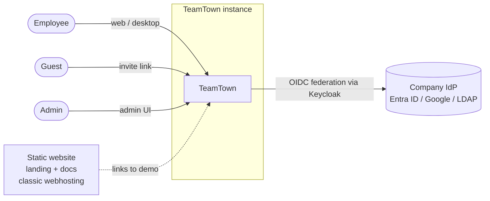
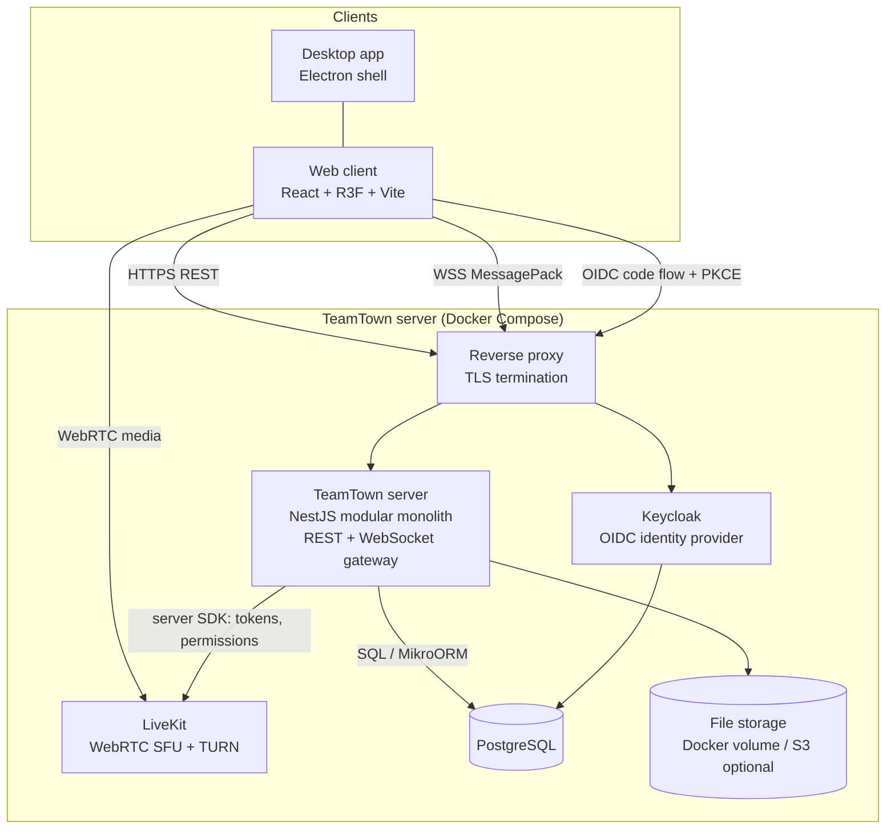
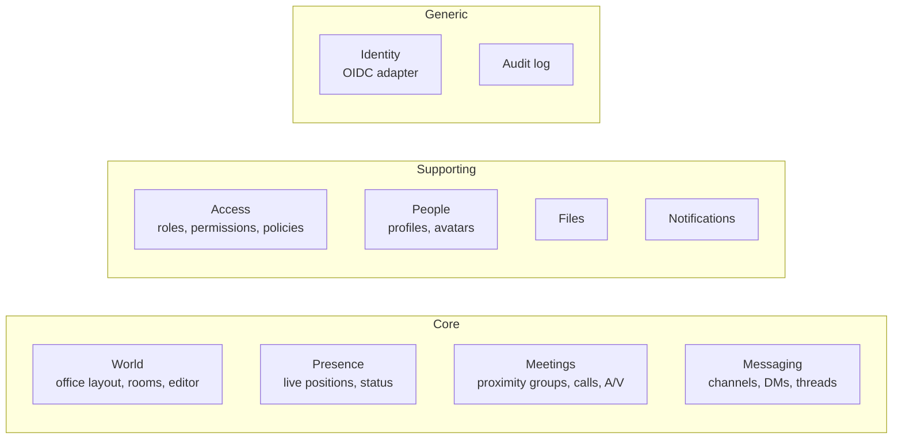
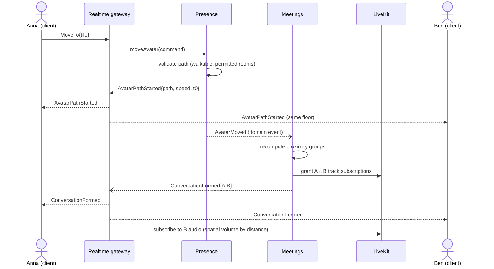

# Architecture Overview

This document follows a lightweight [arc42](https://arc42.org) structure. Decisions are recorded as
[ADRs](adr/README.md). Statements marked **(proposal)** are not yet decided.

## 1. Quality goals

Ordered by priority. When goals conflict, the higher one wins.

| #   | Quality goal                       | Concrete scenario                                                                                                                             |
| --- | ---------------------------------- | --------------------------------------------------------------------------------------------------------------------------------------------- |
| 1   | **Privacy & security**             | No movement or attendance history is ever persisted. A locked room's audio cannot be received by anyone outside, even with a modified client. |
| 2   | **Maintainability & evolvability** | A new contributor can add a feature inside one bounded context without touching others. Module boundaries are enforced by tooling.            |
| 3   | **Usability & accessibility**      | Every feature is usable without the 3D view (list mode, keyboard, screen reader).                                                             |
| 4   | **Performance**                    | 60 fps with 50 avatars on an integrated GPU; others see your movement in < 150 ms.                                                            |
| 5   | **Operability**                    | A self-hosted installation runs with a single `docker compose up` on a small VPS.                                                             |

## 2. Constraints (decided)

| Constraint                                                                                                                                              | Source                                                     |
| ------------------------------------------------------------------------------------------------------------------------------------------------------- | ---------------------------------------------------------- |
| Open source under **AGPL-3.0**                                                                                                                          | [ADR-0002](adr/0002-open-source-agpl-single-tenant.md)     |
| **Single-tenant, self-hostable**; public showcase instance                                                                                              | [ADR-0002](adr/0002-open-source-agpl-single-tenant.md)     |
| Showcase runs on a **small VPS via Docker Compose**; the owner's classic webhosting (PHP/MySQL, no SSH) only serves static content (landing page, docs) | [ADR-0013](adr/0013-deployment-vps-docker-compose.md)      |
| **TypeScript** end-to-end, **pnpm + Turborepo** monorepo                                                                                                | [ADR-0003](adr/0003-typescript-monorepo-pnpm-turborepo.md) |
| Target: **50–500 people** per instance                                                                                                                  | Product decision                                           |
| Docs and code in **English**; UI in **English + German**                                                                                                | [ADR-0016](adr/0016-i18n-english-german.md)                |

## 3. System context

## 4. Containers

| Container           | Responsibility                                                                                                                   | Technology                                                                                          |
| ------------------- | -------------------------------------------------------------------------------------------------------------------------------- | --------------------------------------------------------------------------------------------------- |
| **Web client**      | UI chrome, isometric world rendering, media UI                                                                                   | React, React Three Fiber (Three.js), Radix + Tailwind, Vite                                         |
| **Desktop app**     | Native shell: tray, OS notifications, screen picker, auto-update, deep links                                                     | Electron                                                                                            |
| **TeamTown server** | All business logic in bounded-context modules; REST API; WebSocket realtime gateway; issues LiveKit tokens and track permissions | NestJS, MikroORM                                                                                    |
| **Keycloak**        | Login, SSO federation, MFA, passkeys                                                                                             | Keycloak (OIDC)                                                                                     |
| **LiveKit**         | Audio, video, screen share routing (SFU), built-in TURN                                                                          | LiveKit server                                                                                      |
| **PostgreSQL**      | Persistent state (shared by server and Keycloak, separate schemas or databases)                                                  | PostgreSQL                                                                                          |
| **Reverse proxy**   | TLS, routing                                                                                                                     | Caddy ([ADR-0017](adr/0017-runtime-infrastructure.md))                                              |
| **Observability**   | Metrics, logs, traces, dashboards (admin-only)                                                                                   | OTel Collector, Prometheus, Loki, Tempo, Grafana ([ADR-0019](adr/0019-observability-full-stack.md)) |

**Realtime gateway placement ([ADR-0022](adr/0022-realtime-and-media-topology.md)):** Runs inside the server process as its own module.
With 50–500 users per single-tenant instance, one process is enough. The gateway talks to the domain
only through application-layer ports, so it can be extracted into a separate process later.

## 5. Building blocks (bounded contexts)

See [domain-model.md](domain-model.md) for the full model and context map.

## 6. Runtime scenarios

### 6.1 Walking up to a colleague (proximity conversation)

Key points: **the server is authoritative** over position and over who may hear whom. Clients only
animate and attenuate volume. Who may receive which track is enforced in LiveKit by the server.

### 6.2 Knocking on a room

1. The client sends `KnockOnRoom{roomId}`.
2. Access checks `room.enter` and evaluates the room's door mode (`knock`).
3. Presence holds the avatar at the door. Occupants with `room.admit` receive `KnockRequested`.
4. On `AdmitKnock`, the avatar is let in and Meetings adds the person to the room call.
   On reject or a 60 s timeout, the requester is notified.

### 6.3 Posting a message

1. `POST /channels/{id}/messages` → Messaging application service → `Access.can(user, "message.post", channel)`.
2. The message is persisted in a transaction with a domain event recorded in an **outbox** table ([ADR-0018](adr/0018-transactional-outbox.md)).
3. The outbox relay publishes `MessagePosted`. The gateway pushes it to subscribed clients, and Notifications evaluates mentions.

## 7. Cross-cutting concepts

| Concept                        | Approach                                                                                                                                                                                                                                  |
| ------------------------------ | ----------------------------------------------------------------------------------------------------------------------------------------------------------------------------------------------------------------------------------------- |
| **Architecture style**         | Modular monolith, DDD, hexagonal (ports and adapters) per module ([ADR-0004](adr/0004-modular-monolith-ddd-hexagonal.md))                                                                                                                 |
| **Inter-module communication** | Synchronously via a module's public application API (facade) only. Asynchronously via domain events on an in-process event bus. Never import another module's internals.                                                                  |
| **Contracts**                  | REST: OpenAPI generated from DTOs. Realtime: Zod schemas in `packages/contracts`, documented as AsyncAPI ([ADR-0007](adr/0007-realtime-websocket-messagepack.md))                                                                         |
| **Errors**                     | Expected business failures are returned as `Result` values in the domain and application layers. Exceptions are reserved for programming errors and infrastructure failures. All are mapped to RFC 9457 problem details at the HTTP edge. |
| **Authorization**              | Each application command checks permissions through the `AccessPolicy` port ([permissions.md](permissions.md))                                                                                                                            |
| **Privacy**                    | Presence is in-memory only. No telemetry ([ADR-0024](adr/0024-search-postgres-fts-no-telemetry.md)). See [privacy-and-security.md](privacy-and-security.md)                                                                               |
| **i18n**                       | All UI strings in message catalogues (EN base, DE). Server errors carry codes, never translated text.                                                                                                                                     |
| **Observability**              | Structured JSON logs, OpenTelemetry traces and metrics, full Grafana stack always on ([ADR-0019](adr/0019-observability-full-stack.md)); no personal data in any telemetry                                                                |
| **Configuration**              | Environment variables validated at startup (fail fast), documented in `.env.example`                                                                                                                                                      |

## 8. Further documents

- [Domain model & context map](domain-model.md)
- [World & realtime](world-and-realtime.md)
- [Audio & video](audio-video.md)
- [Permissions model](permissions.md)
- [Privacy & security](privacy-and-security.md)
- [Deployment](deployment.md)
