# Roadmap

> **Status: order decided 2026-10-29.** Milestone contents may be refined during planning.
> Principle: build a **walking skeleton** through all layers first, then thicken vertically.
> Every milestone ends with something demoable on the showcase instance.

```mermaid
gantt
    dateFormat  X
    axisFormat  M%s
    section Foundation
    M0 Foundation           :m0, 0, 1
    section MVP
    M1 Walking skeleton     :m1, after m0, 1
    M2 Talk                 :m2, after m1, 2
    M3 Write                :m3, after m1, 2
    M4 Govern               :m4, after m3, 1
    M5 Build your office    :m5, after m2, 2
    M6 MVP hardening        :m6, after m5, 1
    section After MVP
    M7+ Delight & reach     :m7, after m6, 3
```

| Milestone                  | Goal                                                 | Content (proposal)                                                                                                                                                                 |
| -------------------------- | ---------------------------------------------------- | ---------------------------------------------------------------------------------------------------------------------------------------------------------------------------------- |
| **M0 Foundation** ✅       | Repo is ready for contributors                       | Monorepo (pnpm + Turborepo), lint, boundaries and test setup, GitHub Actions, Docker Compose dev stack (Postgres, Keycloak, LiveKit), design tokens, CLAUDE.md, contributing guide |
| **M1 Walking skeleton** ✅ | Log in, see the office, walk, see others             | OIDC login, a hard-coded demo office (two floors, floor switcher), avatar movement (server-authoritative), presence via WebSocket, Electron shell starts the web app               |
| **M2 Talk**                | Proximity audio and room meetings                    | LiveKit integration, proximity groups, room meetings, knock, door states, screen share, direct call                                                                                |
| **M3 Write**               | Channels and DMs                                     | Messaging context, threads, mentions, reactions, room walls, files, search                                                                                                         |
| **M4 Govern**              | Rights and roles                                     | Scoped RBAC, custom roles, room and channel policies, guest links, audit log                                                                                                       |
| **M5 Build your office**   | Self-service office                                  | Tile-grid editor, furniture catalogue, tracing image, setup wizard                                                                                                                 |
| **M6 MVP hardening**       | Production-ready showcase                            | Demo mode (guest login, demo bots, nightly reset), load test, a11y audit, privacy page, i18n DE complete, backups, website on webhosting, VPS deployment                           |
| **M7+ Delight & reach**    | Selected from the [idea catalogue](brainstorming.md) | e.g. calendar, town hall, emotes, integration bots, mobile companion                                                                                                               |

**M0 notes:** done on 2026-10-30. Moved to M1: Postman collections for the REST API and OpenTelemetry
instrumentation of the server (the observability stack itself is running).

**M1 notes:** done on 2026-10-30 ([feature spec](../features/m1-walking-skeleton.md)), including the items moved
from M0: Postman collection (`postman/`) and OpenTelemetry instrumentation (ADR-0030). Not yet on the showcase
instance; deployment is part of M6.

**M2 notes:** M2a proximity conversations done on 2026-10-30
([feature spec](../features/meetings-proximity-conversations.md)). M2b room calls, door modes and knock done on 2026-10-30
([feature spec](../features/meetings-room-calls-and-knock.md)). M2c part 1, direct calls, done on 2026-10-30
([feature spec](../features/meetings-direct-calls.md)). Next: M2c camera, then screen share.

M2 and M3 can be developed in parallel by different contributors because they are separate bounded
contexts ([domain model](../architecture/domain-model.md)).
